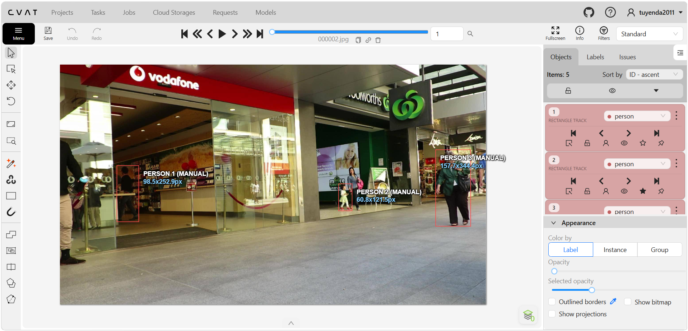
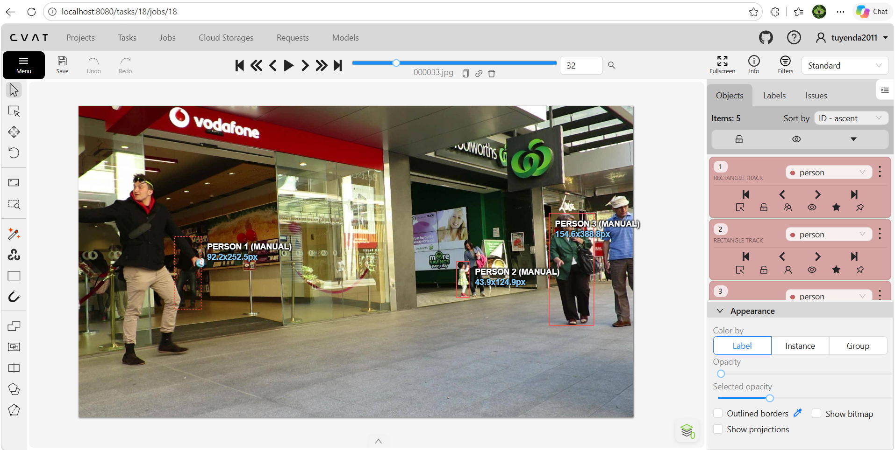
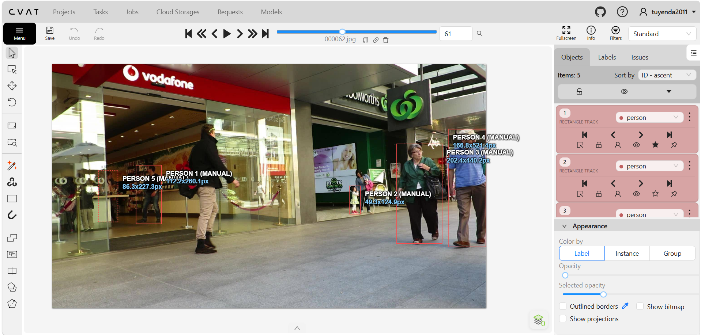

# Báo cáo cá nhân — Đặng Anh Tuyền — 2A202603039


## 0. Thông tin học viên

- Họ tên: Đặng Anh Tuyền.
- MSSV: 2A202603039.
- Mã đề: **A**.
- Email: 26ai.tuyenda@vinuni.edu.vn
- Link repository: https://github.com/tuyenda2011/K5-L2-Day5-DangAnhTuyen-2A202603039-MOTTracking
- Job CVAT: http://localhost:8080/tasks/18/jobs/18
- Giờ bắt đầu: 4h20 chiều
- Giờ kết thúc: 6h30 tối

### Đối chiếu mã người

Đối chiếu theo bảng nhận diện đề A và ba ảnh chụp bài làm. ID trên CVAT không phải mã P của đề.

| Mã | Dấu hiệu nhận diện | ID trên ảnh CVAT | Track XML | Track MOT |
|---|---|---:|---:|---:|
| P1 | Người áo đen bên trong Vodafone | 1 | 0 | 1 |
| P2 | Người sát bên trái cửa kính Vodafone, vòng tham chiếu tại frame 61 | 5 | 4 | 5 |
| P3 | Người áo xanh lá, quần đen, mang túi đen bên phải | 3 | 2 | 3 |
| P4 | Người đội mũ sáng, áo polo xanh dương, quần nâu bên phải | 4 | 3 | 4 |
| P5 | Em bé mặc đồ sáng, giày đỏ cạnh người lớn mang túi hồng | 2 | 1 | 2 |

## 1. Xem trước đoạn video (CP0)

| Mã | Frame xuất hiện thực tế | Frame cuối thấy được | Rẽ / dừng / đổi tốc độ ở frame | Bị che ở frame | Ghi chú |
|---|---|---|---|---|---|
| P1 | 0 | 149 | Khoảng 60–75: xoay thân từ hướng ngang sang hướng ra cửa, tiến về phía camera; sau đó tiếp tục đi ra | 41-49| Không xác định được một đoạn dừng hẳn từ các frame đối chiếu |
| P2 | 61 | 149 | Khoảng 60–90: từ phía trong cửa hàng đi ra cùng P1; 90–149 tiếp tục tiến ra cửa, chưa thấy rẽ hoặc dừng rõ | 0-60 | Không dùng riêng frame tham chiếu 61 để kết luận frame đầu xuất hiện |
| P3 | 0 | 149 | Trong các mốc 0–149 quan sát được: đi về phía camera, không thấy rẽ hoặc dừng rõ; kích thước người tăng dần | Không bị che | Đổi kích thước box không tự chứng minh người tăng tốc |
| P4 |30| 149 | Trong các mốc 30–149 quan sát được: đi về phía camera cạnh P3, không thấy rẽ hoặc dừng rõ | 0-38 | Đã thấy người đội mũ, áo xanh ở frame 30, sớm hơn mốc bắt đầu track 40 |
| P5 | 0 | 145 theo file xuất  | Khoảng 0–30: bước sang phải cạnh người lớn; khoảng 30–100: gần như đứng tại chỗ, có cử động chân nhỏ; đoạn sau bị che nên khó kết luận chuyển động | 109-135 và bị che tiếp ở 147 đến hết | Mốc 145 là frame cuối có box trong file xuất, không phải frame đầu xuất hiện |

## 2. Keyframe và thời gian (CP1, CP4)

Tổng thời gian từ 16:20 đến 18:30 là **130 phút**. Do không ghi thời gian riêng từng người, cột thời gian dưới đây phân bổ đều: **130 ÷ 5 = 26 phút/người**. Đây là ước tính trung bình trên toàn thời gian làm bài (có thể bao gồm xem trước, review và xuất file), không phải thời gian gán nhãn thực đo của từng track.

| Mã | Track XML | Số keyframe | Keyframe ở frame | Số frame có mặt | KF/100 frame | Thời gian (phút) | Chỗ khó |
|---|---:|---:|---|---:|---:|---|---|
| P1 | 0 | 71 | Xem track 0 tại mục 5 | 140 | 50,7 | 26 | Người ở xa, hình nhỏ nên khó nhìn rõ mép cơ thể và căn bounding box, nhất là khi bị che |
| P2 | 4 | 39 | Xem track 4 tại mục 5 | 89 | 43,8 | 26 | Người nhỏ trong khung hình, khó xác định chính xác đỉnh đầu, chân và hai mép box |
| P3 | 2 | 92 | Xem track 2 tại mục 5 | 150 | 61,3 | 26 | Người tiến gần camera, kích thước trong ảnh tăng nên phải chỉnh vị trí và kích thước box nhiều lần |
| P4 | 3 | 53 | Xem track 3 tại mục 5 | 110 | 48,2 | 26 | Người tiến gần camera, box lớn dần và cần chỉnh để bám sát toàn thân |
| P5 | 1 | 48 | Xem track 1 tại mục 5 | 119 | 40,3 | 26 | Em bé có kích thước nhỏ, khó nhìn rõ và kéo chỉnh mép box chính xác khi bị che một phần |
| **Tổng** | | **303** | | **608** | **49,8** | **130** | |

Mật độ keyframe cả bài = 303 ÷ 608 × 100 ≈ **49,8 keyframe / 100 frame**.

P3 có nhiều keyframe nhất: **92**. Người tiến gần camera và chiếm diện tích lớn dần trong ảnh, nên tôi phải chỉnh vị trí và kích thước bounding box nhiều lần để box bám sát toàn thân.

P1 và P3 vượt ngưỡng 50 keyframe / 100 frame.
P1 thì người quá bé và xuất hiện nhiều và mình làm có thẻ thấy được
P3 thì to và nhìn rõ có thể bb nhiều 

Công cụ hỗ trợ: [Timeline bài làm](../../timeline.html).

## 3. Đoạn bị che (CP2)

Người bị che: **P1**, tương ứng PERSON 1, track XML 0 và track MOT 1.

Các mốc sau được trích từ nhãn xuất; [XÁC NHẬN] khớp diễn biến thực tế.

| Mốc | Frame CVAT |
|---|---:|
| Bắt đầu che một phần, bật occluded | 32 |
| Mất hẳn, bật outside | 40 |
| Hiện lại, tắt outside | 50 |
| Thấy rõ trở lại, tắt occluded | 55 |

- Đoạn outside: **40–49**, tổng **10 frame ≈ 0,33 giây** ở 30 fps.
- Đoạn occluded có box: **32–39 và 50–54**, tổng **13 frame**.
- File xuất giữ **cùng ID** trước và sau đoạn outside; thời gian vắng nhỏ hơn ngưỡng 60 frame của lớp.
P1 người trong cửa hàng thì nhìn rất bé nhưng vẫn có thể bb nhưng mà khi có người đi qua che mất người P1 thì để outside. Nếu bị che nhiều quá thì mới để outside còn nếu bị che nhưng mà vẫn thấy nửa người thì vẫn để occluded được

**Trước đoạn che — frame 1:**



**Trong đoạn che một phần — frame 32:**



Có thể thấy là tay của người đi qua che 1 phần người P1 nên để occlued

**Sau đoạn che — frame 61, vẫn PERSON 1:**



Nguồn ảnh: MOT17, MOTChallenge (Milan et al., 2016). Ảnh chụp giao diện CVAT của bài làm.

## 4. Tự review ID (CP3)


Lượt 1 theo từng người, đi ngược frame 149 về 0; lượt 2 theo cảnh, nhảy 10 frame. Ghi lỗi trước khi sửa. Ít nhất 3 dòng nếu có lỗi; nếu thực sự không có lỗi sau hai lượt, ghi một dòng xác nhận theo đề.

Nếu nhìn bằng mắt thường thì có để vẫn bb được và theo mình làm thì thấy không có lỗi gì cả. 
- Khó khăn gặp phải: NGười bé thì bo viền box hơi khó và ảnh mờ thì hơi khó nhìn. Người to như P3: "Phụ nữ áo xanh" thì bb phải chỉnh liên thục vì người đó đi liên tục
- Thuận lợi: dùng property thì gán bbox nhanh hơn nhưng vẫn phải back lại kiểm tra và bo viền lại nhưng làm nhanh hơn là phải bo từng mép 1

## 5. File xuất và kết quả tự kiểm (CP4)

| Kiểm tra | Kết quả |
|---|---|
| File MOT 1.1 | `src/exports/DangAnhTuyen_mot.zip` |
| File CVAT for video 1.1 | `src/exports/DangAnhTuyen_cvat_video.zip` |
| Số track ID trong gt.txt | **5** |
| Tổng số box MOT | **608** |
| Số track trong XML | **5** |
| ZIP không kèm ảnh | Script không báo lỗi ảnh kèm trong ZIP |
| P1 outside ở frame 40–49 không có dòng trong gt.txt | Đúng theo thống kê file MOT |
| Job đã completed | Đã xong và xuất kết quả nộp trong repo |

Lệnh tự kiểm:

```powershell
python src/check_submission.py --mot src/exports/DangAnhTuyen_mot.zip --cvat src/exports/DangAnhTuyen_cvat_video.zip
```

Kết quả thực chạy trên hai ZIP hiện có:

```text
Số frame in theo CVAT (bắt đầu từ 0). Trong gt.txt, frame_id = frame CVAT + 1.

=== File MOT 1.1: DangAnhTuyen_mot.zip ===
  Số track ID: 5   |   Tổng số box: 608
  [OK]        Đúng 5 track ID.

  Track | Frame có mặt | Số frame | Đoạn vắng (outside)
      1 |   0–149      |      140 | 40–49
      2 |   0–145      |      119 | 109–135
      3 |   0–149      |      150 | -
      4 |  40–149      |      110 | -
      5 |  61–149      |       89 | -


=== File CVAT for video 1.1: DangAnhTuyen_cvat_video.zip ===

  Track | Nhãn   | Frame thấy | Keyframe | KF/100 frame | Frame occluded | Lần bật outside
      0 | person |        140 |       71 |         50.7 |             13 |               1
              Track 0: keyframe ở frame [0, 3, 4, 7, 9, 12, 14, 16, 17, 18, 20, 24, 26, 28, 29, 30, 31, 32, 33, 39, 50, 51, 52, 54, 55, 56, 57, 58, 59, 60, 61, 62, 63, 65, 66, 67, 68, 69, 70, 71, 72, 76, 80, 81, 82, 83, 84, 85, 86, 87, 88, 90, 94, 96, 97, 98, 100, 110, 111, 112, 115, 116, 117, 118, 119, 120, 130, 139, 140, 144, 149]
  [CẢNH BÁO]  Track 0: 51 keyframe / 100 frame > 50. Quá dày, dồn keyframe vào chỗ rẽ / dừng / bị che.
      1 | person |        119 |       48 |         40.3 |              8 |               2
              Track 1: keyframe ở frame [0, 1, 3, 4, 5, 8, 11, 12, 14, 18, 19, 21, 22, 23, 24, 25, 28, 32, 35, 37, 40, 42, 46, 65, 68, 70, 71, 72, 74, 75, 76, 78, 79, 80, 81, 82, 83, 87, 102, 106, 107, 108, 136, 137, 138, 139, 140, 143]
      2 | person |        150 |       92 |         61.3 |              0 |               0
              Track 2: keyframe ở frame [0, 1, 2, 3, 4, 5, 6, 8, 14, 16, 17, 18, 19, 20, 22, 24, 26, 27, 33, 34, 35, 36, 38, 40, 41, 42, 43, 45, 46, 48, 50, 51, 52, 53, 54, 55, 56, 57, 60, 61, 63, 64, 65, 66, 67, 68, 69, 70, 71, 72, 74, 76, 77, 78, 79, 82, 83, 84, 85, 86, 88, 90, 92, 93, 96, 97, 99, 100, 101, 102, 103, 110, 116, 118, 120, 122, 123, 125, 126, 127, 129, 130, 131, 136, 137, 138, 140, 143, 144, 145, 146, 149]
  [CẢNH BÁO]  Track 2: 61 keyframe / 100 frame > 50. Quá dày, dồn keyframe vào chỗ rẽ / dừng / bị che.
      3 | person |        110 |       53 |         48.2 |              0 |               0
              Track 3: keyframe ở frame [40, 42, 44, 46, 47, 48, 50, 51, 53, 55, 57, 60, 61, 63, 64, 65, 66, 68, 69, 70, 71, 72, 74, 75, 76, 77, 78, 79, 82, 83, 84, 85, 86, 87, 89, 90, 93, 94, 96, 99, 100, 110, 119, 120, 125, 126, 127, 129, 130, 132, 133, 140, 149]
      4 | person |         89 |       39 |         43.8 |              7 |               0
              Track 4: keyframe ở frame [61, 62, 63, 64, 65, 66, 67, 68, 69, 70, 71, 72, 73, 74, 75, 76, 78, 79, 80, 81, 82, 83, 84, 85, 86, 87, 88, 89, 90, 99, 100, 110, 112, 119, 120, 121, 130, 140, 149]

  Tổng: 303 keyframe / 608 frame có mặt = 49.8 keyframe / 100 frame
  [OK]        Đọc được 5 track từ annotations.xml.

=== Tóm tắt ===
  Lỗi: 0   |   Cảnh báo: 2
  Không có lỗi định dạng. Mở CVAT xem lại từng [CẢNH BÁO]; cảnh báo đúng ý bạn thì ghi lý do vào báo cáo.
```

Kết quả: **0 lỗi, 2 cảnh báo** về mật độ keyframe. Script không có ground truth để xác nhận đúng người, chất lượng box hay tính MOTA / IDF1.

### Khó khăn

- Trong lúc gán nhãn, mình thấy người ở xa có kích thước nhỏ và ảnh hơi mờ nên khó xác định mép cơ thể để căn box. Mình phải phóng to ảnh và tua lại các frame gần nhau để chỉnh cho sát hơn. Với P3 và P4, người tiến gần camera nên kích thước thay đổi liên tục, khiến mình phải chỉnh box nhiều lần.
- Bài vẫn còn hai cảnh báo keyframe quá dày ở P1 và P3. Trong quá trình làm, mình chỉnh box khá thường xuyên vì muốn box bám sát người, nên số keyframe còn nhiều. Mình cần xem lại các đoạn chuyển động đều để giảm những keyframe không cần thiết.
## 6. Ba câu kết

1. Nếu được gán lại, bạn sẽ đặt keyframe khác ở đâu? Vì sao?

Nếu được gán lại thì mình sẽ bo viền mép tốt hơn 

2. Có chỗ nào bạn không chắc “cùng ID hay ID mới”? Bạn đã quyết định và ghi chú thế nào?

Trong 1 khoảng frame ngắn mà bị che khuất thì mình vẫn để cùng ID vì đó vẫn là 1 đối tượng

3. Một lỗi ID trong job của bạn (nếu không còn sót, chọn lỗi đã sửa) có thể làm xe tự lái dự đoán sai chuyển động của người đó như thế nào? Lỗi đó ảnh hưởng MOTA hay IDF1 nhiều hơn?

Thiếu bbox có thể làm cho hệ thống nhận diện người chậm, thiếu lịch sử chuyển động có thể gây ra va chạm.


## Bonus (nếu làm)
Bài này lab coach nói không có bonus

## 7. Tài liệu tham khảo và công cụ AI đã dùng

- Hướng dẫn lab: [CHECKPOINTS.md](../../CHECKPOINTS.md), [GUIDELINE.md](../../docs/GUIDELINE.md), [RUBRIC.md](../../RUBRIC.md), [SUBMISSION.md](../../SUBMISSION.md).
- Công cụ tự kiểm: `src/check_submission.py`; timeline: `tools/lab05/timeline.py`.
- **ChatGPT/Codex:** hỗ trợ làm việc bằng cách giải thích yêu cầu bài, hướng dẫn cài đặt, tải dữ liệu, giải thích lệnh và kết quả tự kiểm; hỗ trợ viết báo cáo bằng cách tổng hợp số liệu từ hai ZIP, đối chiếu mã người, chèn liên kết ảnh và soạn các phần có dữ liệu xác thực.
